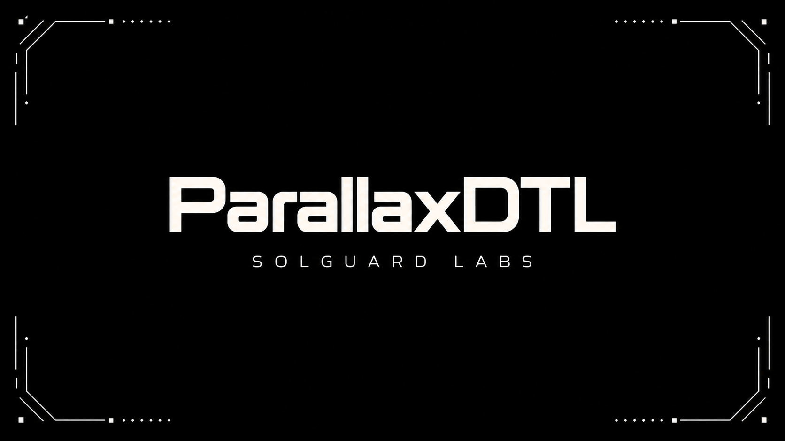
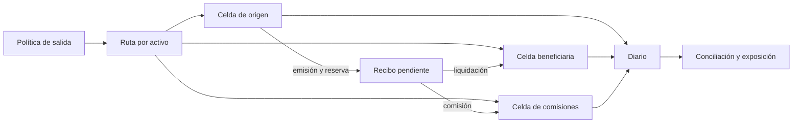

# ParallaxDTL



ParallaxDTL es un motor de conciliación de liquidez entre celdas operativas. Emite recibos de pago, reserva importes en la celda de origen y liquida principal entre rutas, beneficiarios y tesorería. El núcleo está escrito en C11; una CLI JSON y pruebas Node reproducen las transiciones sin servicios externos.

## Arquitectura



El modelo distingue `reserve` (saldo de la celda), `reserved_out` (obligaciones pendientes) y `available = reserve − reserved_out`. Cada recibo fija bruto, comisión, neto, ruta, política, activo, nonce y digest de la ruta. El diario registra mutaciones con secuencia y digest; el reporte muestra exposición por ruta y digest del estado.

## Inicio rápido

Requiere Node.js 20+ y un compilador C11 (`gcc`, `clang` o `cc`; en Windows, el script admite GCC mediante WSL).

```bash
npm run build
npm test
npm run ci
./build/parallaxdtl flow
```

En Windows, `node scripts/build.mjs` genera `build/runner.json` con la invocación adecuada. Sin argumento, la CLI ejecuta `flow`.

| Escenario | Operación | Resultado |
| --- | --- | --- |
| `snapshot` | Configuración de políticas, rutas y celdas | Suministro y exposición inicial |
| `flow` | Reequilibrio, consolidación, recibo, liquidación y salida | Comisión y diario |
| `cancel` | Cancelación de un recibo pendiente | Reserva liberada |
| `fee-rotation` | Cambio de tarifa previo a emisión | Tarifa vigente en el recibo |

Una tarifa de 200 bps aplicada a 700 unidades genera una comisión de 14 y un neto de 686. La rotación a 350 bps antes de emitir un recibo de 800 genera una comisión de 28 y un neto de 772. Los importes son unidades enteras del activo del reporte; no hay conversión implícita de decimales.

## Conservación y control

El cierre global comprueba `suministro inicial + emisión posterior − quema posterior = reservas de celdas + salidas externas`. Las transferencias y liquidaciones internas no crean suministro. Este control convive con estados de celdas y recibos, políticas de salida, compatibilidad de activo/ruta y comprobaciones de disponibilidad. La exposición muestra pendientes, liquidado, cancelado, presupuesto de salida, utilización y puntuación de salud.

La arquitectura, fórmulas, ejecución y controles se describen en [docs/](docs/arquitectura.md). La política de comunicación privada está en [SECURITY.md](SECURITY.md).

## Componentes

- `src/pdtl_ledger.c`: estado, políticas, celdas, recibos y conciliación.
- `src/pdtl_hash.c` y `src/pdtl_journal.c`: identificadores y diario determinista.
- `src/pdtl_scenarios.c` y `src/pdtl_json.c`: recorridos y salida JSON.
- `tests/node/`: contratos de CLI, operaciones, serialización y determinismo.
- `scripts/`: compilación, pruebas y recuento de líneas versionadas.

El proceso mantiene estado en memoria; no expone RPC, persistencia ni custodia. Los digests son identificadores deterministas, no firmas digitales. Una integración con redes requiere diseño y revisión propios. Licencia: [LICENSE](LICENSE).
