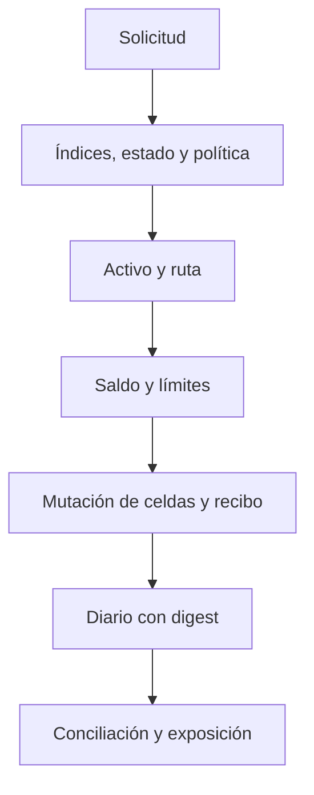

# Política de seguridad

ParallaxDTL distribuye un motor C11 de estado local y una CLI. No incorpora endpoints de red, claves, contratos desplegados ni custodia de fondos. La revisión operativa se centra en integridad de estado, restricciones de ruta y política, ciclo de vida de recibos y reproducibilidad del diario.

Las condiciones rechazadas devuelven código y detalle de error. Las pruebas cubren emisión, liquidación, cancelación, salida, rotación de tarifa, serialización y conservación. `conservation_ok` confirma solo la igualdad global indicada; no sustituye una revisión integral de reglas de negocio.

## Comunicación responsable

Si identifica un problema de seguridad, evite publicar detalles técnicos o secuencias de abuso en issues abiertos. Utilice [GitHub Security Advisories](../../security/advisories/new) e incluya commit, precondiciones, impacto, pasos de reproducción y evidencia mínima. No utilice activos o sistemas de terceros para validar un informe.

## Mantenimiento

Las solicitudes pasan por pruebas automatizadas y revisión de diferencias. Los artefactos de versión deben corresponder con `main`, `production` y la etiqueta anotada. Consulte [controles operativos](docs/seguridad-operativa.md) para supuestos y límites técnicos.
