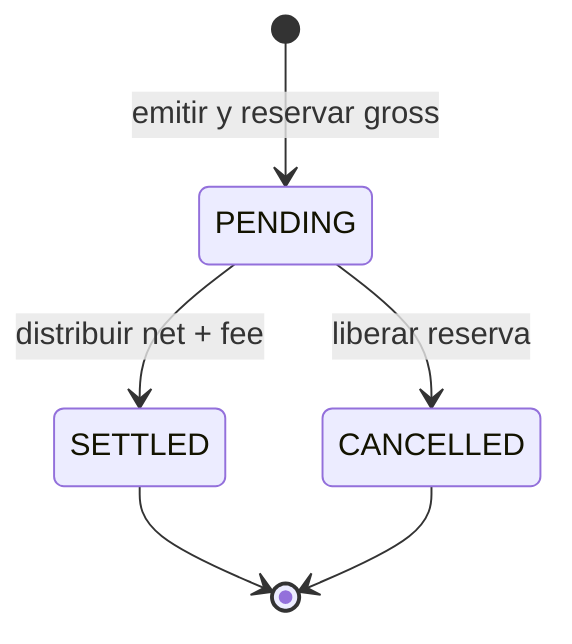
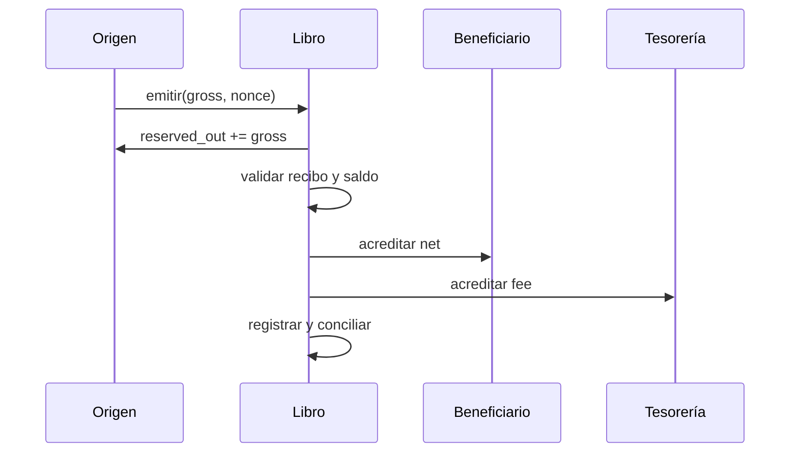

# Arquitectura

Una **política** fija operaciones permitidas, demora de retiro, reserva mínima y presupuesto máximo de salida. Una **ruta** agrupa celdas del mismo activo bajo una política y define comisión en puntos básicos y destino de comisiones. Cada **celda** tiene propietario, estado, reserva y compromiso pendiente. Un **recibo** atraviesa `PENDING → SETTLED` o `PENDING → CANCELLED`.

`pdtl.h` fija estructuras y API; `pdtl_ledger.c` aplica validaciones y mutaciones; `pdtl_hash.c` y `pdtl_journal.c` identifican estado y registran operaciones; `pdtl_scenarios.c` compone recorridos y `pdtl_json.c` serializa el resultado.

La emisión captura el digest de la ruta. Los reportes contienen un `state_digest` y digests por celda, recibo y ruta para comparar ejecuciones equivalentes. No son firmas ni registros persistentes. La capacidad es fija: 12 políticas, 16 rutas, 40 celdas, 80 recibos y 320 entradas de diario; el exceso devuelve `PDTL_ERR_CAPACITY`.
