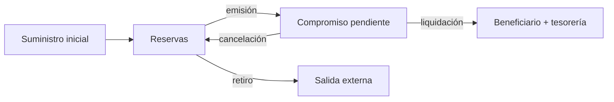

# Modelo económico

`PdtlAmount` es un entero sin signo de 64 bits. Los importes de un recibo usan unidades del activo de su ruta. La comisión trunca hacia abajo:

```text
fee = floor(gross × fee_bps / 10 000)
net = gross − fee
available(cell) = reserve(cell) − reserved_out(cell)
```

Con `gross = 800` y `fee_bps = 350`, `fee = 28` y `net = 772`. La tarifa máxima de ruta es 10 000 bps. La comisión se acredita a la celda de tesorería configurada y no se sustrae dos veces del principal.



La emisión reduce disponibilidad, pero no la reserva. Liquidar debita el bruto de la celda pagadora, acredita `net` al beneficiario y `fee` a tesorería, y extingue el compromiso. Cancelar extingue el compromiso sin transferir principal. Retirar reduce reserva e incrementa salidas externas.

```text
initial_supply + minted_after_genesis - burned_after_genesis
  = total_cell_reserves + external_withdrawals
```

Los escenarios no emiten ni queman después de génesis. `reserved_out`, `settled_in` y `settled_out` son métricas auxiliares; las exposiciones por ruta son vistas del libro, no saldos sumables al suministro. `utilization_bps = floor(reserved_out × 10 000 / reserves)` si hay reservas; `max_exit_budget = floor(reserves × max_exit_bps / 10 000)`. La puntuación de salud es una métrica local, no una garantía de solvencia externa.
