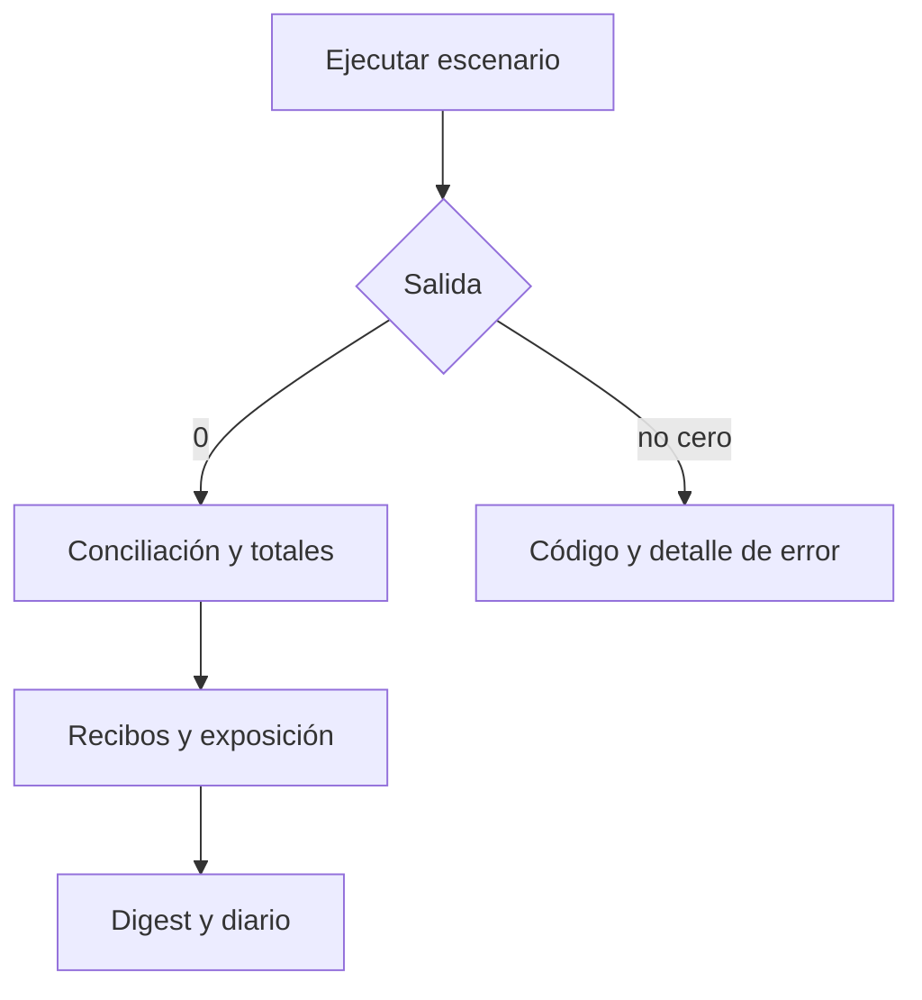

# Operación local

```bash
npm run build
npm test
npm run ci
npm run loc
./build/parallaxdtl snapshot
./build/parallaxdtl flow
./build/parallaxdtl cancel
./build/parallaxdtl fee-rotation
```

`build.mjs` descubre un compilador C11 y registra el runner en `build/runner.json`; en Windows admite GCC de WSL. `npm test` reconstruye y ejecuta `node:test`. `npm run ci` añade un inventario de líneas versionadas. No hay dependencias npm de terceros.

El JSON incluye `scenario`, `network_id`, `state_digest`, `conservation_ok`, `surface`, `totals`, `cells`, `receipts`, `routes`, `settlement` y `journal_tail`. Para revisar una transición, compare `state_digest` y `totals`; después, el recibo, la ruta y el diario. `journal_tail` solo contiene las entradas más recientes.



`fee-rotation` cambia la ruta de 200 a 350 bps antes de emitir un recibo de 800 unidades. La CLI es efímera: no conserva estado entre invocaciones, no consulta oráculos ni sincroniza bloques. Una operación persistente necesitaría almacenamiento transaccional y gestión de concurrencia.
