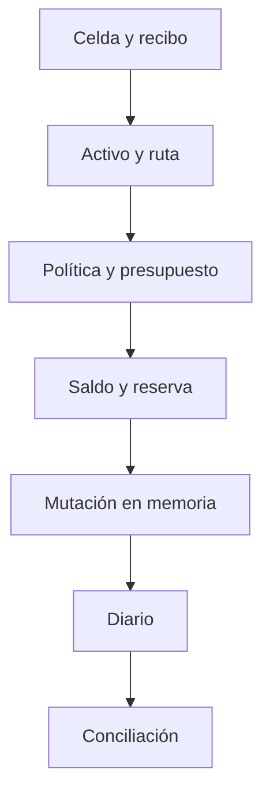

# Controles de seguridad operativa

| Control | Función | Señal |
| --- | --- | --- |
| Estado de celda | Rechaza celdas cerradas | `PDTL_ERR_CELL_CLOSED` |
| Estado de recibo | Restringe transiciones desde pendiente | `status` y error |
| Activo, ruta y política | Compatibilidad de liquidación | Campos de recibo y celdas |
| Saldo disponible | Descuenta compromiso antes de transferir o retirar | `reserve`, `reserved_out`, `available` |
| Política | Acota retiros y cierres | Presupuesto y estado |
| Diario | Secuencia, importe y digest | `journal_tail` |
| Conservación | Suministro frente a reservas y salidas | `conservation_ok` |

Los controles se aplican en etapas distintas. La exposición observa compromisos y utilización; el cierre global verifica conservación de unidades. Ninguna de esas señales prueba autenticidad de una orden, finalización en una red externa o integridad de datos persistidos.

El motor no implementa autenticación, firmas, persistencia ni consenso. El digest identifica estado local, pero no tiene las propiedades criptográficas necesarias para decisiones de custodia. Integrar un backend transaccional requeriría autorización, atomicidad, idempotencia, recuperación ante reinicios y revisión independiente del modelo económico. El canal de divulgación está en [SECURITY.md](../SECURITY.md).
